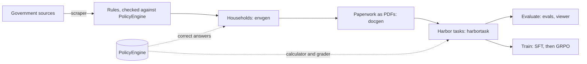

# ttune

An RL environment for public-benefits eligibility, in the [Harbor](https://github.com/laude-institute/harbor) format, and the pipeline to train a small open model on it with little compute.

An agent gets a household's paperwork as PDFs (an application, pay stubs, a lease, benefit letters) and a terminal. It works out SNAP, the EITC, Medicaid and WIC, using [PolicyEngine](https://github.com/PolicyEngine/policyengine-us) as a calculator, and writes its answer to a file. A separate verifier scores that answer against PolicyEngine's exact result. Every household is synthetic, so there's no private data.

- **Status:** [ROADMAP.md](ROADMAP.md) has what's done, in progress and next, and every finding so far.
- **Results:** the [eval viewer](https://leonliu368.github.io/ttune/) has every experiment and task: a leaderboard per experiment, each task's documents as the agent sees them, and every trial's answer and agent steps next to PolicyEngine's answer.
- **How it works:** [docs/architecture.md](docs/architecture.md).

## How it works



1. **Rules.** [`scraper/`](scraper/) fetches official SNAP, EITC, Medicaid and poverty-line sources each month. `python -m scraper check` compares every value with PolicyEngine's.
2. **Households.** [`envgen/`](envgen/) samples households: 200 typical ones (ID), and 200 unusual ones (OOD: rare household shapes, incomes at a cutoff, held-out states). PolicyEngine computes each one's correct answers.
3. **Paperwork.** [`docgen/`](docgen/) turns each household into the documents a caseworker would see. It adds distractors (a stale pay stub, a partner who moved out) and gaps (a missing pay stub). Where a gap could change an answer, the right answer becomes "unknown".
4. **Tasks.** [`harbortask/`](harbortask/) packages each case as a Harbor task. The agent's container is offline and holds the PDFs and `benefits-calc`. A separate container holds the answer key and scores `/app/answer.json`.
5. **Splits.** 1,000 training and 200 validation tasks are built from a secret seed, so their answers stay private. The 400 published cases are the holdout, never trained on.
6. **Evaluate and train.** [`evals/`](evals/README.md) and the GitHub Actions workflows run models on all of this for $0. [`sft/`](sft/README.md) holds the fine-tuning data and a free Colab notebook.

## Results so far

Qwen3 4B Instruct, self-hosted on GitHub's CPU runners for $0, on the same 200 ID and 200 OOD households. Mean reward from 0 to 1.

| How the model works | ID | OOD |
|---|---|---|
| One reply, from a clean written summary | 0.44 | 0.35 |
| One reply, from the paperwork as text | 0.45 | 0.31 |
| As an agent in Harbor, with the PDFs and the calculator | 0.23 | 0.14 |
| Floor: answer "no" to everything | 0.34 | 0.21 |

As an agent, the 4B model mostly gives up: it greps the PDFs instead of reading them, answers "unknown" and never runs the calculator. The fine-tuning step now in progress targets exactly that, using 1,200 scripted demonstrations of the task done well. Details are in [ROADMAP.md](ROADMAP.md#findings-so-far).

## Quick start

Python 3.11 or later. PolicyEngine needs its own requirements file because it's large.

```bash
pip install -r requirements-dev.txt -r requirements-docgen.txt   # tests, documents, tasks
pip install -r requirements-envgen.txt                            # PolicyEngine (for answers and the calculator)
python -m pytest -q                                               # the PolicyEngine tests skip without it

python -m harbortask build --samples                              # rebuild the 6 sample tasks in tasks/
harbor run -p tasks/benefits-5e5278f3df -a oracle -e docker       # the reference answer: reward 1.0 (needs Docker, Harbor 0.25.0)
python -m viewer build && python -m http.server -d _site          # the eval viewer, locally
```

[docs/commands.md](docs/commands.md) lists every command. [docs/workflows.md](docs/workflows.md) covers the GitHub Actions workflows that run the evals, build the splits and write the training data. It also lists the secrets they need and what each one costs.

## Repository

| Path | What's in it |
|---|---|
| [`scraper/`](scraper/) | Fetch, parse and check official sources ([data/README.md](data/README.md#scraper)) |
| [`envgen/`](envgen/) | The household schema, samplers and PolicyEngine answers |
| [`docgen/`](docgen/) | Documents, distractors and gaps, the truth that follows the documents, and the PDF renderer ([data/documents/README.md](data/documents/README.md)) |
| [`harbortask/`](harbortask/) | Harbor tasks: generator, verifier, calculator, reward-hack audit, splits, agentic baseline, SFT data ([tasks/README.md](tasks/README.md)) |
| [`evals/`](evals/README.md) | Run a model over a set, score it, compare ID with OOD |
| [`viewer/`](viewer/README.md) | The eval viewer: experiments, tasks with their PDFs and trajectories, runs; and a local server that can start runs |
| [`data/`](data/README.md) | Raw sources, parsed rows, checks, household sets and document packets |
| [`tasks/`](tasks/README.md) | 6 sample tasks, the reward-hack audit, and the split manifests |
| [`sft/`](sft/README.md) | Fine-tuning: scripted demonstrations, the Colab notebook, the teacher route |
| [`evals/results/`](evals/results/) | Every eval run: per-household results and `comparison.md` |
| [`docs/`](docs/README.md) | Guides, plus the research notes behind the project |
| [`.claude/skills/`](.claude/skills/) | Claude Code skills used to build the environment ([docs/05-skills.md](docs/05-skills.md)) |

## Why this environment

Language models still get benefits and tax rules wrong often. The best model answers about 77% of SNAP questions correctly ([Public Benefits Bench](https://www.vals.ai/benchmarks/public-benefits-bench)), and the best gets 78% of full tax returns right, only with web search ([TaxCalcBench](https://github.com/column-tax/tax-calc-bench)). Those benchmarks use small, fixed, hand-written test sets covering one program each, and none trains a model.

| What ttune does | Closest earlier work |
|---|---|
| Exact answers from a rules engine for every case | TaxCalcBench, τ-bench |
| Unlimited generated cases from a seeded generator | Reasoning Gym, GSM-Symbolic |
| A planned in- vs out-of-distribution test, one kind of shift per family | GSM-Symbolic |
| Wrongful denials cost double in the score | None found |
| Missing paperwork must be flagged, and "unknown" is right only where a gap leaves the answer open | None found |
| An RL environment to train in, audited against shortcut answers | Reasoning Gym (no benefits programs) |
| Rules checked against official sources every month | None found |

The full survey is in [docs/06-research-report.md](docs/06-research-report.md).

## Constraints

- **Little compute.** Verification runs on CPU. The models are small open-weight ones (4–8B), fine-tuned with LoRA. Evals run on GitHub's free runners, and training on free Colab GPUs.
- **Exact rewards.** Scores come from a deterministic verifier, not an LLM judge.
- **Generated, not hand-written.** One generator yields as many tasks as needed, and the training answers stay secret.
- **Money only with approval.** Paid models are refused unless a run explicitly allows them. So far the project has spent $0.11.
