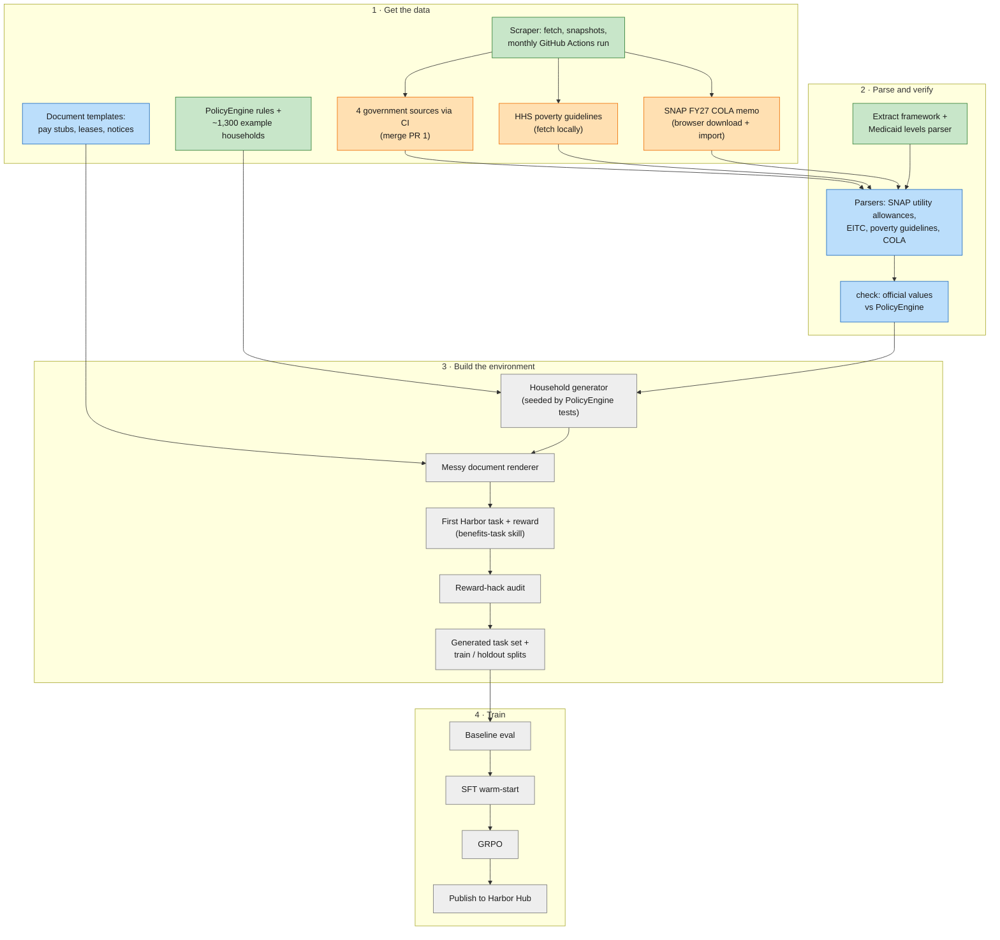

# Roadmap

What's built, what's in progress, and what's next for the benefits-eligibility environment. Update this file whenever a box changes state.

Legend: green = done, orange = in progress, blue = next up, grey = later.

## In progress

- [ ] Merge [PR #1](https://github.com/LeonLiu368/ttune/pull/1) (first CI snapshot: SNAP utility allowances, EITC Rev. Proc., Medicaid levels, W-2 template).
- [ ] HHS poverty guidelines: fetch from a home connection and commit (`python -m scraper fetch --source hhs-poverty-guidelines`).
- [ ] SNAP FY27 COLA memo: download in a browser and `python -m scraper import fns-snap-cola-fy27 <files> --url <pdf link>`.

## Next up

1. **Parsers** for the remaining rule sources, one module each in `scraper/parsers/`:
   SNAP utility allowances (xlsx), EITC Rev. Proc. 2025-32 (pdf), poverty guidelines (html), COLA memo (pdf).
2. **`check` command:** compare each parsed value with the matching PolicyEngine parameter and report mismatches.
3. **Document template sources:** find public-domain or permissively licensed pay stub, lease and benefit-notice layouts; add them to `sources.json` as `kind: ["templates"]`.

## Known blockers

| Source | Problem | Workaround |
|---|---|---|
| `hhs-poverty-guidelines` | aspe.hhs.gov returns 403 to GitHub's runners; works from a home connection | `where: local`, so CI skips it; fetch by hand |
| `fns-snap-cola-fy27` | www.usda.gov returns 403 to the scraper from GitHub and from a home connection | `where: manual`; download in a browser, then `import` |
| `medicaid-eligibility-levels` | The CSV has no "as of" date | Check freshness against the dataset page on data.medicaid.gov before relying on it |

The scraper doesn't spoof a browser to get past these. If a site blocks it, the source is fetched by hand.

## Housekeeping

- Bump `actions/checkout`, `actions/setup-python` and `peter-evans/create-pull-request` off Node 20 (read their changelogs first).
- Test the ttune skills in `.claude/skills/` with skill-creator once the first Harbor task exists.
