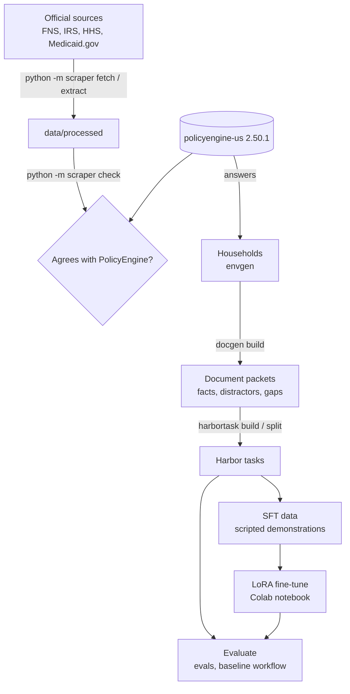

# How ttune works

This is the end-to-end picture: what each stage takes in and puts out, where the correct answers come from, and how the reward is computed. Each package's own README has the details. Words in *italics* are defined in the [glossary](#glossary) at the end.



## 1. Rules: the scraper

[`scraper/`](../scraper/) fetches the official sources listed in [`data/sources.json`](../data/sources.json) into dated snapshots in `data/raw/`, and parses them into one shared row format in `data/processed/`. `python -m scraper check` compares every parsed value with the PolicyEngine parameter it should match, and writes the result to `data/processed/checks/`. The Scrape sources workflow runs this monthly and opens a PR.

The scraper doesn't feed the answers directly; PolicyEngine does. Its job is to show PolicyEngine is right, or flag where it isn't. Hawaii's SNAP shelter cap is one example: FNS says $1,306, PolicyEngine says $1,036. [ROADMAP.md](../ROADMAP.md#findings-so-far) lists every difference.

## 2. Households: envgen

[`envgen/`](../envgen/) defines the household schema (`household.py`) and two samplers (`sample.py`, `edges.py`). A household has a state, members (age, relationship, pregnancy, disability, student status, citizenship, monthly income by type) and expenses (rent, heating or cooling, childcare, medical costs).

- **ID set:** 200 typical households across 41 states.
- **OOD set:** 200 unusual households in three equal *shift families*:
  - rare household shapes, such as multigenerational households, mixed citizenship, self-employment or a college student;
  - *threshold edges*: incomes within 1% of a real cutoff, found by raising wages until PolicyEngine's answer flips;
  - 10 *held-out states*.

`envgen/truth.py` runs PolicyEngine on each household for fixed periods:

| Program | Period | Answer |
|---|---|---|
| SNAP | October 2026 (federal fiscal year 2027) | Eligible, and the monthly benefit |
| EITC | Tax year 2026 | Eligible, and the annual credit for the household |
| Medicaid | 2026, under the state's rules (not CHIP) | Which members qualify |
| WIC | October 2026 | Which members qualify |

Only declared income counts. Benefits PolicyEngine could add on its own (SSI, state supplements, TANF) are set to $0, so the answer matches what the case says. The sets live in [`data/households/`](../data/households/README.md).

## 3. Paperwork: docgen

[`docgen/`](../docgen/) turns each household into a *packet*: an application plus the documents that back it. Those are pay stubs, earnings ledgers, benefit letters, child-support histories, a lease, utility and medical bills, childcare invoices, and enrollment and medical letters.

- **Exact amounts.** Every printed amount is chosen so that the stated conversion rules give back the household's exact monthly figures. Examples: average the two most recent stubs × 2.15 for pay every two weeks; weekly unemployment × 4.3. `docgen.documents.established()` reads the facts back off the documents, and the build checks they match.
- **Distractors.** These test careful reading and don't change the answer: a stale pay stub, a rent figure on the application that the lease contradicts, a partner on the lease who moved out, a name written two ways.
- **Gaps.** About a third of packets are missing a document: pay stubs, the lease page with the rent, or a childcare receipt. `docgen/truth.py` tries the missing figure at 9 points across its plausible range, plus its real value. Any decision that changes becomes *unknown*. A missing amount isn't scored, and the missing document belongs on the answer's missing-information list.

`docgen/render_pdf.py` draws the PDFs with reportlab, and the output is byte-identical across runs. Details are in [data/documents/README.md](../data/documents/README.md).

## 4. Tasks: harbortask

[`harbortask/build.py`](../harbortask/build.py) writes one Harbor task per document packet:

```
benefits-<hash>/
├── task.toml            config: offline, a non-root agent ("caseworker"), a separate verifier
├── instruction.md       what the agent reads: the programs, periods, rules and answer format
├── environment/         the agent's image: python:3.12-slim, pdftotext, jq, tmux, policyengine-us,
│                        benefits-calc, and the PDFs in /app/case/
├── tests/               the verifier's image: Reward Kit, the scoring code, truth.json
└── solution/solve.sh    the reference answer, for Harbor's Oracle agent
```

- **The agent's container.** It has the PDFs and `benefits-calc` (`harbortask/calc.py`), a command-line wrapper that runs PolicyEngine on a household's facts. The calculator runs the same code that wrote the answer key, so correct facts give the right answer. The skill being tested is reading the paperwork, applying the rules and spotting what's missing.
- **The verifier's container.** It holds the answer key and the grading code. Only `/app/answer.json` crosses over. Neither container has a network.
- **Opaque task ids.** Each id is a hash of the case id, so a task doesn't name its case.

## 5. The reward

The task verifier (`harbortask/verify.py`) scores three dimensions and takes a weighted mean:

| Dimension | Weight | What it measures |
|---|---|---|
| Eligibility | 0.60 | Each program's yes/no, per member for Medicaid and WIC. A wrong "not eligible" costs double: it's the error that costs people food or care. "Unknown" is right only on a decision a missing document leaves open. |
| Amount | 0.25 | SNAP and EITC amounts when truly eligible: full credit within 5% or $10, falling to 0 at 25% off. With no amount to score, this dimension equals eligibility. |
| Missing information | 0.15 | The share of truly missing documents the answer lists, minus 0.25 for each wrong item. Items come from a fixed list of 8 document categories. |

A missing or unreadable answer scores 0 on every dimension.

The one-shot evals in `evals/` use the same eligibility and amount scoring (`evals/score.py`), weighted 2/3 and 1/3, with no missing-information dimension. The agentic baseline reports both, so it compares directly with the one-shot runs.

**Reward-hack audit.** `python -m harbortask audit` scores degenerate answers on every case and requires each to stay below 0.5: empty, malformed, all yes, all no, all unknown with every document flagged, and random. The best of them scores 0.38. The audit runs again whenever a split is built.

## 6. Splits and secrecy

| Split | Tasks | Built from | Answers |
|---|---|---|---|
| `train` | 1,000 | Fresh typical households, from a secret seed | Secret |
| `validation` | 200 | Fresh typical households, from a second seed derived from the same secret | Secret |
| `holdout-id` | 200 | The published ID set | Public; never trained on |
| `holdout-ood` | 200 | The published OOD set | Public; never trained on |

- **Secret training answers.** The seed comes from the `TTUNE_TRAIN_SEED` repository secret, so only its owner can regenerate the training answers. That keeps the holdout honest and stops anyone training on the training set's answers.
- **Encrypted outputs.** Generated cases are renamed (`train-0001`) and their seed is blanked. The workflows keep tasks, trajectories and SFT data as artifacts encrypted with the same secret, using AES-256-CBC and PBKDF2 with 200,000 iterations, because any GitHub user can download a public repo's artifacts.
- **Public logs and PRs.** Only aggregate numbers go into them. [docs/workflows.md](workflows.md#privacy-rules) has the rules.
- **No overlap.** The build fails if a training household has the same facts as another household or as a holdout one.

## 7. Evaluation

Two ways to evaluate, both $0 on GitHub's runners:

- **One reply** ([`evals/`](../evals/README.md)): the model reads the case, as a summary or as the paperwork in text, and answers in a single reply. The model runs either self-hosted with llama.cpp on the runner's CPU, or as a free model on OpenRouter.
- **As an agent** (the Baseline workflow, `harbortask/agentic.py`): the model drives Harbor's `terminus-2` agent through each holdout task in Docker, with up to 40 turns and 30 minutes per task. `python -m harbortask agentic collect` scores the trials into the same results format, so `python -m evals compare` and the viewer work unchanged.

Every run lands in `evals/results/<run id>/` with per-household results and a `comparison.md`. The comparison covers mean reward with bootstrap intervals, balanced accuracy and false denials per program, and the OOD shift families. The [viewer](../viewer/README.md) publishes all runs to GitHub Pages.

## 8. Training

1. **Baseline.** As an agent, Qwen3 4B scores 0.23 ID / 0.14 OOD on all 400 holdout tasks: it gives up and never uses the calculator. That leaves almost no reward for RL to learn from, so it gets an SFT warm-start first.
2. **SFT data.** `python -m harbortask scripted` writes one checked conversation per training case, in the exact chat format terminus-2 uses. Each conversation reads every PDF, works out the facts by the rules, runs `benefits-calc` and writes the answer. Every terminal output in it is real, and a missing figure is never filled in from the hidden household. A conversation is kept only if its answer scores 1.0. [sft/README.md](../sft/README.md) has the details.
3. **Fine-tune.** [`sft/colab_sft.ipynb`](../sft/colab_sft.ipynb) trains a LoRA adapter on Colab's free T4 GPU and exports a GGUF for the evaluation workflows.
4. **Evaluate again.** The fine-tuned model runs on the same 400 holdout tasks as the baseline.
5. **GRPO.** RL in the environment comes next, once the fine-tuned model earns enough reward to learn from.

## Glossary

| Term | Meaning |
|---|---|
| **ID / OOD** | In-distribution (typical households) and out-of-distribution (unusual ones). The OOD set measures generalization. |
| **Shift family** | One kind of OOD change: rare shapes, threshold edges or held-out states. |
| **Threshold edge** | A household whose income is within 1% of a cutoff where PolicyEngine's answer flips. |
| **Packet** | A household's application and supporting documents. |
| **Distractor** | A deliberate oddity in a packet that a careful reader handles but that doesn't change the answer. |
| **Gap** | A deliberately missing document. If it could change a decision, the right answer for that decision is "unknown". |
| **Unknown** | The right answer for a decision a gap leaves open. It's wrong anywhere else. |
| **False denial** | Answering "not eligible" for someone who qualifies. It costs double in the eligibility score. |
| **Balanced accuracy** | The mean of accuracy on truly eligible and truly ineligible decisions. Any blanket answer scores 50%, so it compares fairly across sets. |
| **Oracle** | Harbor's agent that writes the reference answer. It should score 1.0. |
| **terminus-2** | Harbor's general-purpose terminal agent, used for the baseline and matched by the SFT data. |
| **Holdout** | The 400 published cases. They're used only for evaluation and never trained on. |
| **Scripted demonstration** | An SFT example written by code from the documents and checked to score 1.0. It costs no model calls. |
